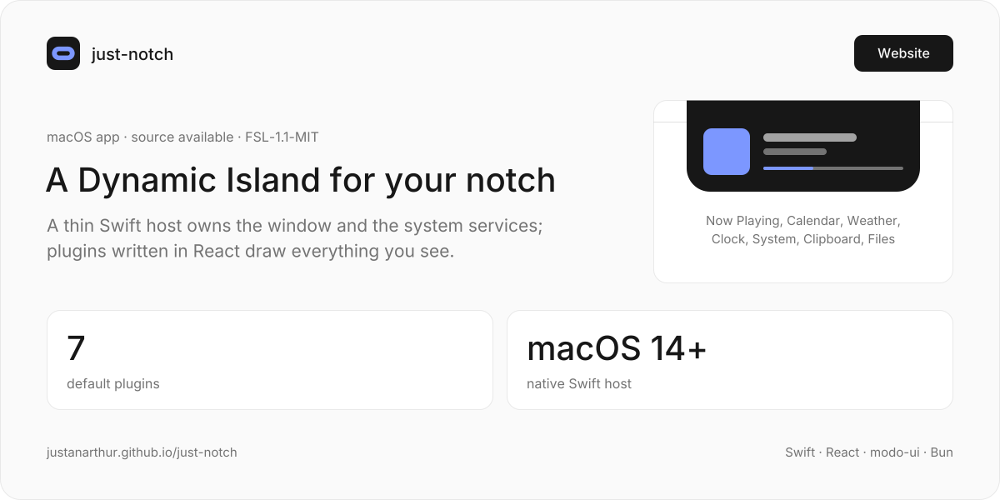
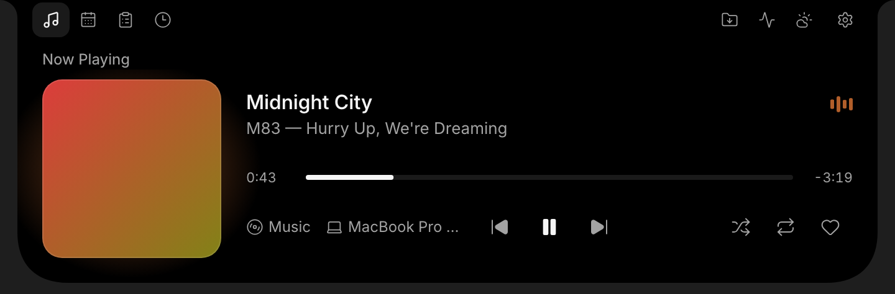
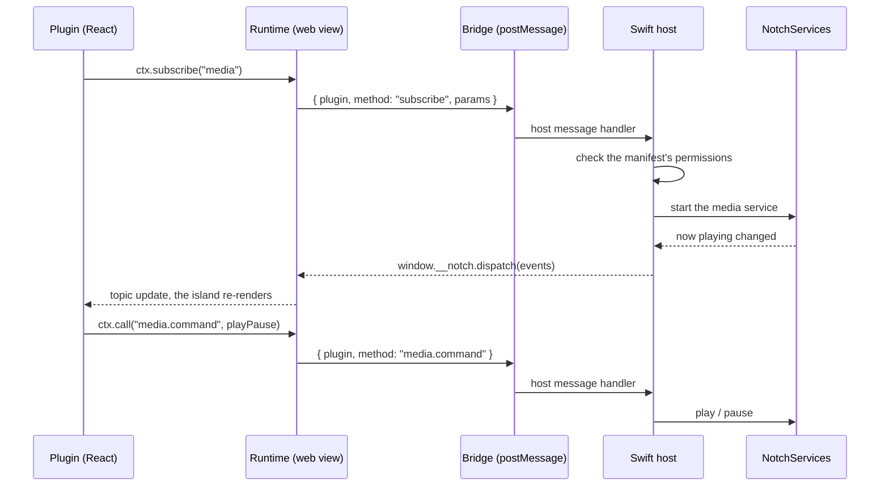
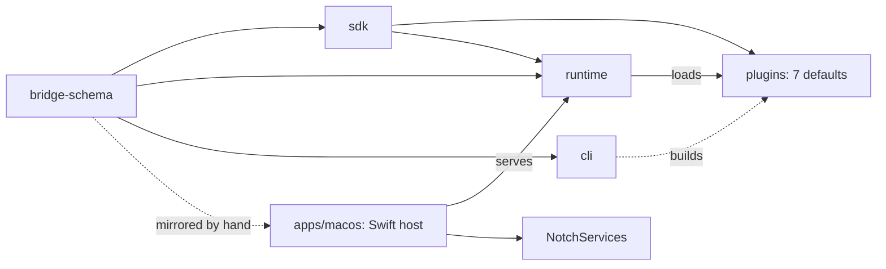

<a href="https://justanarthur.github.io/just-notch/"></a>

# Just Notch

[](https://github.com/justAnArthur/just-notch/actions/workflows/ci.yml)
[](LICENSE.md)

A modular Dynamic Island for the MacBook notch. A thin native Swift host owns the window and the system services; everything you see is React + [`@justanarthur/modo-ui`](https://github.com/justAnArthur/modo/tree/main/ui) in one transparent web view; plugins add the rest.

Seven default plugins, built on the `@justanarthur/modo-ui-notch` kit: Now Playing, Calendar, Weather, Clock (with Pomodoro), System, Clipboard and Recent files. More, such as GitHub and YouTrack, install from the [library](library/README.md).

**[Download for Mac →](https://github.com/justAnArthur/just-notch/releases/latest/download/JustNotch.zip)** · [Website](https://justanarthur.github.io/just-notch/)



## Install

Download [`JustNotch.zip`](https://github.com/justAnArthur/just-notch/releases/latest/download/JustNotch.zip) (or a versioned `JustNotch-x.y.z.zip` from [Releases](../../releases)), unzip, move `JustNotch.app` to Applications. macOS 14+.

The app is signed with the project's own self-signed certificate, not Apple's Developer ID, and isn't notarized, so open it the first time with right-click → Open, or:

```bash
xattr -dr com.apple.quarantine /Applications/JustNotch.app
```

### Updates

The app updates itself with [Sparkle](https://sparkle-project.org): it checks once a day, and on demand from the menu bar icon's **Check for Updates…** or Settings › About. Updates are verified with an EdDSA signature, then installed and relaunched; no second right-click → Open.

Every release is signed with the same certificate, so macOS treats each update as the same app: Calendar, Location, Automation, folder and Bluetooth permissions and the plugins' Keychain items carry over. Releases up to 1.2.x were ad-hoc signed, which made every update a new app; coming from one of those, grant the permissions (and Keychain access) one last time.

## How it works

The Swift host puts one transparent panel over the notch and loads the runtime into its web view. Plugins never touch the system: they ask the runtime, the runtime posts the request over the bridge, and the host checks it against the plugin's manifest before a service in `NotchServices` runs it. State comes back as topic events.



## Develop

```bash
bun install
bun run build                       # runtime + plugins
cd apps/macos && xcodegen && xcodebuild -scheme JustNotch -configuration Debug -derivedDataPath build build
```

Live reload: `bun run dev` in `packages/runtime`, then launch the app with `NOTCH_DEV_URL=http://localhost:5174`. A browser at that URL runs the whole island against a mock host.

Write a plugin: `bun run notch create <id>`, then `bun run notch build --cwd plugins/<id>`. See [`packages/sdk`](packages/sdk/src/index.ts) and [`packages/cli`](packages/cli/README.md).

More plugins live in the [library](library/README.md): optional, released one by one, listed on the [website](https://justanarthur.github.io/just-notch/#library) and installed from Settings › Library after a native consent dialog. Start one with `bun run notch create <id> --library`; [`library/README.md`](library/README.md) covers the manifest, the release flow and the review checklist.

just-notch is `apps/notch` in the just-apps monorepo and builds only inside a just-apps checkout. Layout, conventions and release rules: [`AGENTS.md`](AGENTS.md).

## Structure



```
packages/bridge-schema   the host ⇄ web contract: methods, topics, events, manifest
packages/sdk             @just-notch/sdk: definePlugin, PluginContext, hooks
packages/runtime         the React app in the web view: island, plugin loader, settings, mock host
packages/cli             notch create | dev | build | pack | install | check
plugins/<id>             the default plugins, written against the public SDK only
library/<id>             optional plugins, released on their own and installed from Settings › Library
apps/macos               the Swift 6 host (XcodeGen), Packages/NotchServices for system services
assets/brand             logo, app icon, menu bar glyph, lockups and wordmark masters
site                     the website (GitHub Pages)
```

## Releases

Versioning and GitHub releases run via [just-github-actions-n-workflows](https://github.com/justAnArthur/just-github-actions-n-workflows). A Conventional Commit on `main` scoped to the app (`app`, `macos`, `runtime`, `island`, a plugin id, …) bumps the version in the root `package.json` and tags `just-notch@x.y.z`; the tag builds the app and attaches `JustNotch-x.y.z.zip` and `JustNotch.zip` to the release.

Updates: the build signs the zip with Sparkle's EdDSA private key (the `SPARKLE_PRIVATE_KEY` repository secret) and attaches `appcast.xml`, which installed apps read through `releases/latest/download/`. The matching public key is `SPARKLE_PUBLIC_KEY` in [`apps/macos/project.yml`](apps/macos/project.yml). One-time setup, with [Sparkle's tools](https://github.com/sparkle-project/Sparkle/releases):

```bash
./bin/generate_keys                     # creates the key in your login keychain, prints the public key
# put the public key into SPARKLE_PUBLIC_KEY in apps/macos/project.yml
./bin/generate_keys -x sparkle-private-key
gh secret set SPARKLE_PRIVATE_KEY -R justAnArthur/just-notch < sparkle-private-key
rm sparkle-private-key
```

Keep the key: losing it means users can't update past that release without downloading by hand.

Code signing: the build signs the app with a long-lived self-signed certificate, "Just Notch Self-Signed", so its designated requirement (`identifier "com.justanarthur.justnotch" and certificate leaf = H"…"`) is the same for every release and privacy permissions and Keychain access survive updates. The certificate lives in the `MACOS_CERT_P12` (base64 `.p12`) and `MACOS_CERT_PASSWORD` repository secrets; without them the build warns and falls back to ad-hoc signing. One-time setup, on your Mac:

```bash
apps/macos/scripts/make-signing-cert.sh          # writes ~/Projects/just-notch-signing/, prints the next commands
base64 -i ~/Projects/just-notch-signing/cert.p12 | gh secret set MACOS_CERT_P12 -R justAnArthur/just-notch
gh secret set MACOS_CERT_PASSWORD -R justAnArthur/just-notch < ~/Projects/just-notch-signing/password.txt
# back up cert.p12 and password.txt (e.g. in a password manager), then:
rm -rf ~/Projects/just-notch-signing
```

Keep the certificate too: a new one changes the app's identity, and every user grants permissions again. The clean long-term fix is still a paid Developer ID certificate plus notarization: no right-click → Open, and no `disable-library-validation` entitlement.

## License

[FSL-1.1-MIT](LICENSE.md): source available, free to use, modify and run for anything except a competing product.
Each release turns MIT two years after it ships.
